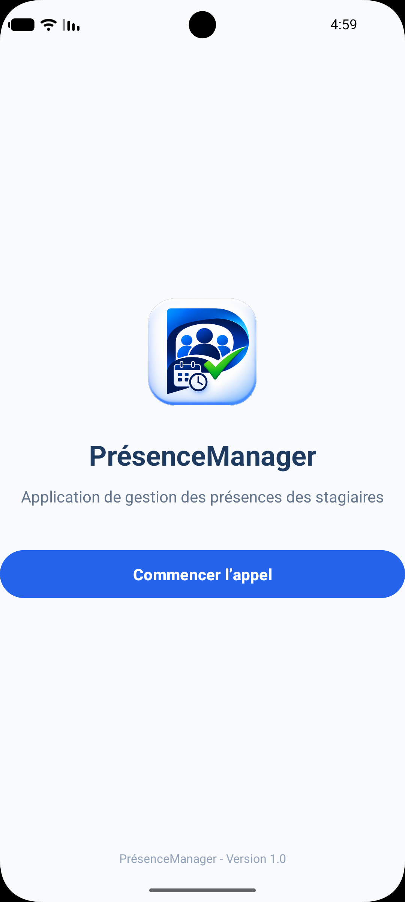
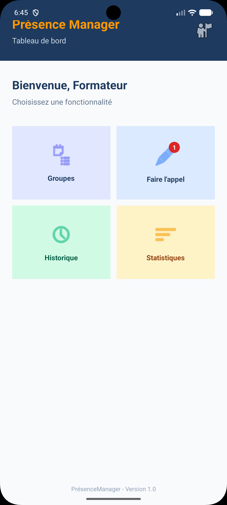
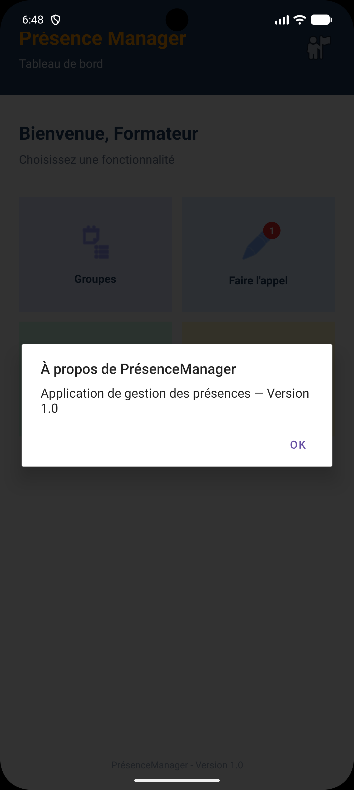
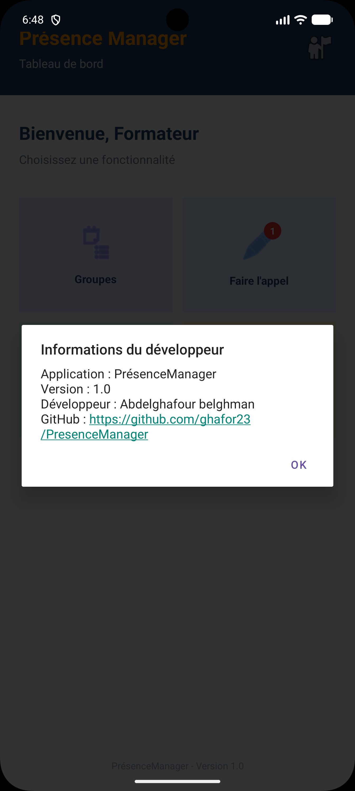

# PrésenceManager

## Description
PrésenceManager est une application mobile Android développée avec Kotlin et XML.

Cette application a pour objectif de faciliter la gestion des présences des stagiaires dans un établissement de formation.

## Technologies utilisées
- Kotlin
- XML
- Android Studio

## Version
1.0

---

## TP01 - Écran d'accueil
Création de l'interface d'accueil de l'application avec le bouton « Commencer l'appel ».

---

## TP02 - Tableau de bord
Création du tableau de bord avec un en-tête, un message de bienvenue, une grille de quatre fonctionnalités (Groupes, Faire l'appel, Historique, Statistiques) et un pied de page.

Layouts utilisés : `ConstraintLayout`, `RelativeLayout`, `LinearLayout`, `GridLayout`, `FrameLayout`.

---

## TP03 - Gestion des événements

### Définitions
- **Événement utilisateur** : action effectuée par l'utilisateur sur l'écran (toucher, appui long, double toucher).
- **Event Listener** : objet qui associe une réaction à un composant. Le Listener est attaché à la vue, et l'événement est traité dans le code Kotlin.

### Différence entre les trois gestes
- **onClick** : un appui bref sur un composant.
- **onLongClick** : un appui maintenu pendant un moment sur un composant.
- **onDoubleTap** : deux appuis rapprochés. Android ne propose pas de `OnDoubleClickListener` standard : on utilise `GestureDetector` avec `SimpleOnGestureListener`.

### Événements traités

| Événement | Méthode | Composant | Action |
|---|---|---|---|
| Clic simple | `setOnClickListener` | `btnCommencer` | Ouvre le tableau de bord |
| Clic simple | `setOnClickListener` | `cardGroupes`, `cardAppel`, `cardHistorique`, `cardStatistiques` | Ouvre l'activité associée à la carte |
| Appui long | `setOnLongClickListener` | `cardGroupes`, `cardAppel` | Affiche un Toast d'aide, sans navigation |
| Double-clic | `GestureDetector` + `onDoubleTap` | `imgProfil` | Affiche la boîte de dialogue « À propos » |
| Clic simple | `setOnClickListener` | `txtFooter`, `txtFooterDashboard` | Affiche la boîte « Informations du développeur » |

### Pages accessibles depuis le tableau de bord
- `GroupesActivity`
- `AppelActivity`
- `HistoriqueActivity`
- `StatistiquesActivity`

Chaque page affiche le titre de la fonctionnalité et le texte « Fonctionnalité en cours de développement ».

### Informations du développeur
Un clic sur le texte « Version 1.0 » (écran d'accueil et tableau de bord) ouvre une boîte de dialogue contenant le nom de l'application, la version, le nom du développeur et un lien GitHub cliquable : https://github.com/ghafor23/PresenceManager

### Captures d'écran TP03

**Tableau de bord**

**Page ouverte par clic simple**

**Boîte de dialogue du double-clic**

**Boîte « Informations du développeur »**

